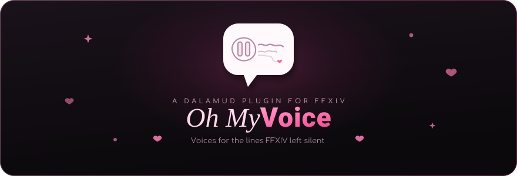
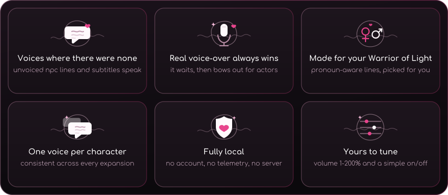
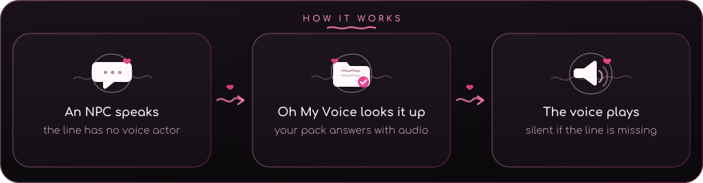

<div align="center">



<p align="center"><a href="#install"></a> <a href="#privacy"></a> <a href="https://github.com/goatcorp/Dalamud"></a></p>
<br>


</div>

## What is Oh My Voice?

Oh My Voice is a Dalamud plugin that gives unvoiced FFXIV dialogue a voice. It
plays pre-generated voice lines from a local pack whenever the game leaves a
line without voice-over.

Install the plugin, drop in a voice pack, and the silence starts talking.
Everything runs locally, nothing is generated while you play, and real
voice-over always wins.

## Why you'll love it

<div align="center">

</div>

## How it works

<div align="center">

</div>

Each spoken line maps to one audio file in your pack. If it is there, you hear
it; if not, the plugin stays silent and quietly notes the gap for later.

<div align="center">

</div>

## Install

**Requirements:** FFXIV with XIVLauncher and Dalamud on Windows, or XIV on
Linux/Wine.

Oh My Voice lives in a **third-party Dalamud repository**. Add the URL once,
and Dalamud handles installs and updates.

### 1 — Add the repository

1. In game, open `/xlsettings`.
2. Go to **Experimental** → **Custom Plugin Repositories**.
3. Paste the Oh My Voice repository URL:

   ```text
   https://repos.codetrunk.eu/cutieway/oh-my-voice/raw/branch/main/repo.json
   ```

4. Click the **+** button, then **Save and Close**.

### 2 — Install the plugin

1. Open `/xlplugins`.
2. Search for **Oh My Voice**, then click **Install** and **Enable**.
3. `/omv` opens the status window whenever you want to check it.

### 3 — Add voice packs

Open `/omv` → **Settings**, enter the **existing pack root**, and click
**Confirm directory**. The root must contain one folder per voice:

```text
<selected pack root>/
  alphinaud/
  thancred/
  urianger/
```

Select the parent folder containing the voice folders, not an individual voice
folder.

Then open `/omv` and press **Reload pack**. Until a pack is installed, the
plugin stays quietly out of the way.

## In game

`/omv` opens the status window and the settings.

| Setting | What it does |
| --- | --- |
| Enabled | Turns the whole plugin on or off |
| Voice pack directory | Pack root containing one folder per voice |
| Volume | Pack audio level, 1–200% |
| Player pronouns | Auto follows your character's sex; or pick They/them, She/her, or He/him |
| Real-VO wait | How long to wait for a real voice actor before starting (ms) |
| Stop on real VO | Cuts your pack line if an actor starts talking |
| Debug logging | Extra detail in `/xllog` |

A missing line is never an error: it is simply silent and recorded for later.
Lines that mention the player in third person have separate she/he recordings;
the plain root is the neutral they/them version and the fallback if a matching
clip is missing. A hand-made `voicelines_override/{id}.ogg` inside a voice
folder always wins over that voice's generated audio.

## Documentation

| Curious about | Read |
| --- | --- |
| Making a pack, Qwen3-TTS, quality, benchmarks | [docs/QWEN3-TTS.md](docs/QWEN3-TTS.md) |
| Runtime pipeline, pack format, event log | [docs/PLUGIN.md](docs/PLUGIN.md) |
| Building, playtesting, repo layout | [docs/DEVELOPMENT.md](docs/DEVELOPMENT.md) |
| Which characters are covered | [docs/VOICES.md](docs/VOICES.md) |
| The dialogue database | [tools/xivdata/README.md](tools/xivdata/README.md) |
| Speaker embeddings | [tools/xvector/README.md](tools/xvector/README.md) |

## Privacy

No analytics, no crash reporting, and no network requests: the plugin reads the
game and local files only. Your pack stays in the directory you selected;
`events.jsonl` and settings stay in the plugin's config folder. Nothing leaves
your machine.

Pack audio is generated from game audio; use and share it thoughtfully.

## Credits

- **Qwen3-TTS** — the voice model behind pack generation. Weights are Apache-2.0.
- **Dalamud** and **FFXIVClientStructs** — the plugin framework and game structures.
- **Lumina** — reading the game's `sqpack`.
- **vgmstream** — cutscene audio extraction.
- **NAudio** and **Concentus** — playback and pure-managed Opus decoding. The
  Ogg-Opus decode is adapted from **XivVoices**.

## License

[AGPL-3.0](LICENSE.md). Model weights keep their own Apache-2.0 license, and
generated voice packs are your responsibility to use and share fairly.

<br>

<div align="center">


<p align="center">made with love for the scenes that deserved a voice</p>

</div>
