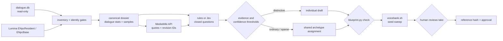

# Voice blueprints

A blueprint is one character's synthetic voice, written as a closed-vocabulary
selection rather than free prose. The pipeline is VoiceDesign → reference clip →
ICL prompt → dialogue lines; the blueprint describes the first step and keeps
every later step reproducible.

```mermaid
flowchart LR
  db["dialogue.db<br/>read-only"] --> inv["canonical identity inventory"]
  game["Lumina NPC index"] --> inv
  inv --> dossier["character dossier<br/>dialogue + provenance"]
  dossier --> wiki["MediaWiki API<br/>cached + revisioned"]
  dossier --> classifier["rules or Jev<br/>typed decisions"]
  wiki --> classifier
  classifier --> assign{"individual design<br/>or shared archetype"}
  assign --> bp["draft profile / registry"]
  bp --> render["tools/blueprint.py<br/>validate + render"]
  render --> vd["VoiceDesign<br/>neutral archon"]
  render --> vdm["VoiceDesign<br/>mood archons"]
  vd --> pick{"pack_archon<br/>(one per character)"}
  vdm --> pick
  pick --> icl[create_voice_clone_prompt]
  icl --> lines[Base model<br/>every dialogue line]
```



Nothing here generates audio into a pack. `./scripts/voicebank.sh` renders a
reference plus three neutral sample lines per blueprint, so a voice can be
auditioned before it costs 2,000 lines. Neutral means the identity prompt alone:
no mood block, no emotion.

## Status

Phase 1 remains the existing in-game voice cloning path and is not changed by
the synthetic pipeline. Phase 2 now builds a conservative candidate inventory,
dialogue dossiers, cached wiki enrichment, offline rules and optional Jev
classification, reusable archetype assignments, draft profiles, review reports,
and human audition/approval records. The pipeline stops before runtime pack
generation; approval remains a human action.

| Link | State |
|---|---|
| blueprint → reference clip | **solved.** `tools/blueprint.py` renders and validates the instruct; VoiceDesign turns it into a clip. |
| reference clip → dialogue lines | **solved and deterministic.** Every line is cloned from one frozen clip; same seed reproduces byte-identical audio, five draws verified. |
| game/dialogue/lore → synthetic blueprint draft | **implemented.** `tools/blueprint_pipeline/cli.py` creates dossiers, enriches from MediaWiki, classifies with local rules or opt-in Jev, and routes to a draft profile or shared archetype. |
| draft → approved reference | **human-gated.** Review commands record edits, audition WAV hashes, and approval; no classifier can approve a voice. |

`blueprints/characters/` contains only intentional reviewed profiles. The four
hand-written examples (gerolt, godbert, momodi, nashu_mhakaracca) remain in the
gitignored `blueprints/archive/` as renderer fixtures. Six initial shared
archetypes live in `archetypes/`; all are drafts until a human auditions and
approves a pinned reference.

### The intended pipeline



The earlier survey of the 25 highest-line unvoiced speakers found:

- 22/25 resolve to a wiki page; 3 have none (`QIB`, `wandering minstrel`,
  `BEATINE`). Those are narration/announcer labels, not characters, and must
  fall back to a bank archetype rather than a guess.
- 20/22 infoboxes carry gender + race + clan, 11 also carry age.
- Infobox data is dirty: `race=Hyune` typo, a disambiguation page with an empty
  infobox, a 230-year-old Padjal, a race with no gender. The converter needs an
  explicit rule per case, not a scraper with a shrug.
- The wiki can contain useful character facts, but its descriptions are not
  proof of pitch or timbre. The pipeline keeps source-backed voice claims
  separate from deliberate synthetic casting decisions.
- The MediaWiki API returns an empty body without a `User-Agent`; a fetcher must
  send one or it will silently report "no page".

The initial policy uses a small shared archetype catalog for ordinary or sparse
identities and reserves an individual draft for high distinctiveness scores
with adequate evidence. Archetype choice is deterministic and filters on the
game's own sex field so a masculine assignment never lands on a feminine bank.
Individual drafts no longer inherit acoustics from a bank: their acoustic fields
come from `tools/blueprint_pipeline/casting.py`, which applies readable rules to
game facts (race, clan, sex, body type) plus a stable per-NPC choice. See
`docs/blueprint-decisions.md` for the full decision table.

## Files

| Path | Role |
|---|---|
| `vocabulary.json` | Every allowed value, its render phrase, its acoustic family, the selection rules, the mood presets, and the shared reference script. |
| `schema.json` | Structural JSON Schema. Enum membership and the rules live in the vocabulary. |
| `characters/<id>.json` | Intentional character profiles; generated drafts remain under gitignored `data/blueprints/profiles/`. |
| `archetypes/*.json` | Six shared synthetic profiles, all initially marked draft. |
| `archive/characters/*.json` | Gitignored hand-written examples that proved the pipeline out. |
| `tools/blueprint.py` | Validates a profile and renders the VoiceDesign instruct. |
| `tools/blueprint_pipeline/` | Read-only inventory, dossiers, wiki, Jev, rules, archetypes, generation, review, and reporting components. |
| `tools/voicebank/run.py` | Container-side renderer: reference, N sample lines, report, audition page. |
| `scripts/voicebank.sh` | Host wrapper that runs it inside the `tts-qwen` image. |

## The three layers

1. **Identity** — who the voice is. Constant for the character, identical across
   every line and every archon. This is the only thing a blueprint selects
   directly.
2. **Archon** — a designed performance of that identity: neutral, or one named
   mood. Each archon is its own reference clip and its own cached ICL prompt,
   because the Base model takes audio plus transcript and never an instruction.
   A character's pack uses one archon; see [Archons, not per-line
   moods](#archons-not-per-line-moods).
3. **Reference recording** — one standard script, spoken by the designed voice,
   reused for every character and every archon.

## Selection rules

`select` in the vocabulary is authoritative; the validator enforces it.

| Field | Count | Notes |
|---|---|---|
| `presentation` | exactly 1 | Vocal presentation, not gender identity. |
| `perceived_age` | 0–1 | Perceived vocal age. Lore years are mapped, never copied blindly. |
| `pitch` | exactly 1 | Register only; expression belongs to intonation and mood. |
| `pitch_range` | 0–1 | Omit when unsure. |
| `timbre_primary` | exactly 1 | The main source of character differentiation. |
| `timbre_secondary` | 0–1 | Must be from a different acoustic family; two roughness words is one instruction, not two. |
| `resonance` | 0–1 | Most profiles omit this. |
| `articulation` | exactly 1 | |
| `speaking_pace` | exactly 1 | A voice property, not an emotion. |
| `intonation` | exactly 1 | `natural` unless the source says otherwise. |
| `accent` | 0–1 pair | Profile and strength together or neither. |
| `distinctive_traits` | 0–2 | Embellishments; must not repeat an existing family. |

Extremes are gated: `very_low`, `very_high`, `very_slow`, `very_fast`,
`dramatic`, `melodic`, `monotone`, `slurred`, `drawling`, `staccato`, `sharp`,
`nonhuman`, and `synthetic` require `explicit` or `supported_inference`
evidence. Taste alone cannot produce them.

## Evidence

Every non-null field carries an evidence record:

| Level | Meaning | Needs source + quote |
|---|---|---|
| `explicit` | The source states it | yes |
| `supported_inference` | Several source statements agree | yes |
| `creative_selection` | A design choice inside the vocabulary | no |
| `default` | Project fallback (accent, natural intonation) | no |
| `unknown` | No reliable information; field is null | no |

The point is auditability: after 9,000 profiles, "why does this character sound
like this" must have an answer that is not "the model felt like it".

## Phase 2 operations

The inventory and dossier commands open SQLite read-only. `dialog_speakers`
associations collapse aliases under one `npc_id`; identities with a voiced
alias, ambiguous links, or a normalized-name collision are review-blocked.
Unresolved labels remain review records and never become fabricated NPCs.
Only `dialogue` and `narration` rows enter the dossier. Statistics are
deterministic, and sample selection is stable across runs.

```bash
# Optional localized Lumina metadata. The command prints JSON and does not
# modify the dialogue DB; store the export outside the repository/data tree.
dotnet run --project tools/xivdata -- npc-index --lang en > /tmp/game-npc-index.json

python3 tools/blueprint_pipeline/cli.py inventory --game-index /tmp/game-npc-index.json
python3 tools/blueprint_pipeline/cli.py dossiers --game-index /tmp/game-npc-index.json --limit 25
python3 tools/blueprint_pipeline/cli.py enrich --allow-network --limit 25
python3 tools/blueprint_pipeline/cli.py classify --provider rules --limit 25

# Jev is opt-in. Configure the key in the environment and begin with a pilot.
export TYPESAFE_API_KEY
python3 tools/blueprint_pipeline/cli.py classify --provider jev --allow-network --limit 25

python3 tools/blueprint_pipeline/cli.py inspect npc_1003075 --review-report
python3 tools/blueprint_pipeline/cli.py validate
python3 tools/blueprint_pipeline/cli.py report
```

Wiki lookups and Jev calls require `--allow-network`; Jev defaults to at most 25
records per invocation. Larger batches require `--allow-bulk`, and the CLI
prints request count, approximate input tokens, and a rough cost estimate
before sending. `--resume` reuses matching dossier/config/model results;
`--force` reruns classification and explicitly permits a generated result to
replace a manually reviewed profile. API credentials are read from the named
environment variable and never saved in a profile or cache.

Jev uses TypeSafe System One with `jev-latest` by default. Its `choice`,
`score`, and `noul` answers are retained with probability distributions,
confidence where provided, model version, token usage, and input/config hashes.
Noul is a yes-probability and has no separate confidence field. Thresholds are
initial project settings, not accuracy guarantees; low-confidence decisions
route to review or an archetype. Jev reads text/JSON only: it cannot hear
audition clips or supply citations. Factual citations come from the separate
wiki/game-data evidence collector.

Game race, clan, and sex are identity metadata, never acoustic evidence.
Rules-only presentation defaults to neutral. Every non-null acoustic field is
marked `explicit`, `supported_inference`, `creative_selection`, or `default`;
synthetic choices do not claim what a nonexistent original actor sounded like.
Speech-style measurements and classifications are stored separately and do
not enter the acoustic identity prompt. The neutral reference script remains
unchanged.

Use the review command to preserve a human audit trail:

```bash
python3 tools/blueprint_pipeline/cli.py review edit npc_123456 --by reviewer \
  --changes /tmp/voice-edits.json
python3 tools/blueprint_pipeline/cli.py review audition archetype_neutral_clear_mid \
  --by reviewer --reference /path/to/audition.wav --seed 20261101
python3 tools/blueprint_pipeline/cli.py review approve archetype_neutral_clear_mid \
  --by reviewer --archon neutral
```

An identity edit retires old pins into the history and returns the profile to
`ready_for_audition`. Only human review can set `approved`; generation lookup
reports a profile as usable only after that approval. Draft profiles and
assignment registries are immutable snapshots under gitignored `data/`.

## Archons, not per-line moods

A mood clip is an **archon**: one designed reference plus its cached ICL prompt,
owned by a character. A character has a set of archons — `neutral` always, plus
whichever moods the source justifies — and a pack uses **exactly one of them for
all of that character's lines**.

Presets live in `vocabulary.json`: `neutral`, `calm`, `happy`, `sad`, `angry`,
`fearful`, `secretive`. A profile may override at most two fields of a preset; a
third override means the preset is wrong and should be fixed there, once, for
everyone.

`neutral` is the identity prompt verbatim. Every other archon is
`identity + mood block`, rendered from the same identity text, so the clips
differ only in performance.

**Never select an archon per dialogue line.** Listening on 2026-11-01 was
unambiguous: the archons individually sound excellent, and the shift between
them is far too large to swap mid-conversation — a character reading a tense
line and a calm line would change voice. Archon choice is a casting decision,
recorded as `pack_archon`, defaulting to `neutral`.

**Neutral is the basis.** It is deliberately the least expressive archon and is
what every character packs with. A mood archon is added only when the source
describes how the character sounds *by default* — a manic detective sidekick, a
perpetually merry salesman — never because one scene is emotional.

This is where the designer's judgement earns its keep: the mood archons are the
most striking audio the pipeline produces, so the temptation to attach them per
line is real. Don't. They are casting options, not performance directions.

## Reference script

One text for everyone, 32 words, from `vocabulary.json`:

> Good evening. The road ahead is quiet tonight, although the weather may
> change before morning. Keep to the marked path, and listen for the bells.
> Have you brought everything you need?

It has statements, a clause, and a question, so the clip carries declarative and
interrogative prosody without acting. Target 10–15 s; anything outside 8–18 s is
rejected rather than trimmed. The exact transcript is stored with the clip
because ICL needs `ref_text` to match the audio word for word.

Check the first two seconds of a new clone: there is a known upstream report of
the reference tail leaking into the start of ICL output.

## CLI

```bash
python3 tools/blueprint.py check                       # all profiles
python3 tools/blueprint.py check blueprints/characters/gerolt.json
python3 tools/blueprint.py render gerolt               # neutral instruct
python3 tools/blueprint.py render gerolt --moods       # every mood instruct
python3 tools/blueprint.py plan gerolt --out /tmp/plans
./scripts/voicebank.sh                                  # every blueprint, 3 neutral samples each
./scripts/voicebank.sh gerolt godbert                   # two blueprints
./scripts/voicebank.sh --samples 5 nashu_mhakaracca
./scripts/voicebank.sh --moods all gerolt               # every mood the profile declares
./scripts/voicebank.sh --seeds 5 --samples 2 godbert     # same instruct, five takes
```

`check` also warns when two profiles select an identical identity tuple: with
hundreds of NPCs, accidental clones are the failure mode nobody notices.

## Reconciliation of the two research drafts

`research/grok.md` and `research/chatgpt.md` agree on the shape: select acoustic
dimensions from a controlled list, render a short natural-language instruct,
keep mood separate, use one standard reference script. They differ in detail,
and the tighter rule won each time:

| Question | Grok | ChatGPT | Adopted |
|---|---|---|---|
| Gender field | male / female / neutral | 12 values incl. modifiers | 6 presentations, `presentation` not gender |
| Timbre count | 1–3 | 1 + optional 1 | 1 + optional 1, with family conflicts rejected |
| Reference script | four suggestions | one canonical script | one canonical script |
| Mood application | append to the generation prompt | separate reference clip | separate clip: Base cannot read a mood instruction |
| Emotion in identity | a "baseline emotion" field | forbidden | forbidden, and the validator bans emotion words |
| Prompt length | 15–40 words | 25–45 words | 25–48 words |
| Evidence levels | none | five levels | adopted |

The one thing kept from Grok that ChatGPT omitted: selection counts are part of
the spec, not a style note. "Use one value" and "use up to two" are validated,
not advised.

## Measured on the first bank

Four profiles, two moods each, run 2026-11-01 (`./scripts/voicebank.sh`):

| Voice | Mood | Reference | Ref median F0 | Clone medians (3 lines) |
|---|---|---:|---:|---:|
| gerolt | neutral | 10.9 s | 93 Hz | 87, 92, 89 |
| gerolt | calm | 12.2 s | 78 Hz | 88, 80, 88 |
| godbert | neutral | 10.5 s | 92 Hz | 104, 87, 83 |
| godbert | happy | 9.2 s | 103 Hz | 112, 96, 86 |
| momodi | neutral | 10.2 s | 205 Hz | 210, 205, 183 |
| momodi | happy | 10.7 s | 258 Hz | 192, 186, 168 |
| nashu_mhakaracca | neutral | 10.6 s | 233 Hz | 261, 220, 286 |
| nashu_mhakaracca | happy | 10.6 s | 264 Hz | 314, 296, 265 |

Every reference landed inside the 10–15 s target on the first try, and
presentation separates cleanly: masculine references sit at 78–103 Hz,
feminine at 205–264 Hz.

Two findings for the pipeline:

- **Line pitch scatters by up to ~65 Hz** around the reference median within one
  voice. A blueprint fixes the design, not every frame: budget 2–3 clone lines
  per voice in acceptance, and never judge a profile from one clip.
- **A mood reference does not reliably transfer its pitch.** Momodi's happy
  reference sits 53 Hz above her neutral one, but her happy clones landed
  *below* neutral. Treat mood archons as casting options: audition them, then
  pick one per character. Never bind them to individual lines.

Listening verdict 2026-11-01: neutral and every mood archon sound excellent on
their own. Neutral is correctly the flattest of them, which is exactly what a
pack-wide basis should be.

`report.json` records `ref_seconds`, `ref_f0`, `line_seconds`, and `line_f0`
per take, so a rerun can be compared without re-listening to everything.

## Seed sweeps

`--seeds N` rebuilds the reference N times from the same instruct, offsetting the
plan seed by `--seed-step` (1000 by default). The identity is identical; only
the sampling draw changes. Use it to choose between candidate voices for one
blueprint, not to average them: a character gets one take, and that take becomes
its archon.

Godbert, five takes, two sample lines each (2026-11-01):

| Take | Seed | Ref | Ref F0 | Line F0 |
|---:|---:|---:|---:|---|
| 0 | 20652794 | 10.48 s | 92.0 Hz | 92.3, 87.6 |
| 1 | 20653794 | 10.64 s | 103.4 Hz | 97.6, 108.1 |
| 2 | 20654794 | 10.88 s | 94.5 Hz | 87.3, 92.7 |
| 3 | 20655794 | 10.08 s | 100.4 Hz | 96.2, 94.1 |
| 4 | 20656794 | 10.16 s | 98.4 Hz | 93.8, 94.9 |

Reference pitch spans 92.0–103.4 Hz (11.4 Hz) for one unchanged instruct, and
every take stayed inside the duration target. Seed changes the realized voice,
not the design: it is a casting knob, so a blueprint is only finished once one
take is chosen.

### What pinning actually pins

The **reference clip**, not a line seed. Every dialogue line is generated from
`create_voice_clone_prompt(ref_audio=<frozen wav>)`, so once the reference is
chosen and stored, all ~2,000 lines of that character share one identity — with
no per-line seed at all.

Measured on the Godbert takes above (ECAPA speaker-embedding cosine, 1.0 = same):

| Comparison | Cosine |
|---|---|
| two lines from the *same* take, different line seeds | 0.991–0.994 |
| two lines from *different* takes | 0.984–0.994 |

Six unseeded lines per take, emulating a pack run: take 0 mean 93.9 Hz (sd 5.2),
take 1 mean 96.6 Hz (sd 5.3), gap between takes 2.7 Hz. Per-line scatter within
one take is larger than the mean gap between takes — so a line seed buys nothing
for identity, while the reference clip buys all of it.

A design seed alone is not a durable pin either: dtype, attention backend, torch
build, or a reference-script edit will change the clip under the same seed. Pin
the clip and its hash, and record the seed only for reproducibility:

```json
"archon_pin": {
  "neutral": {
    "design_seed": 20652794,
    "reference_sha256": "<sha256 of refs/neutral.0.wav>",
    "ref_seconds": 10.48,
    "ref_f0": 92.0,
    "pinned_on": "2026-11-01"
  }
}
```

A hash mismatch on rebuild means the voice changed and must be re-approved,
rather than silently re-casting the character.

## Known limits

- Accent clauses are unverified: Qwen3-TTS has no accent mode, so treat them as
  hints until a listening test proves otherwise.
- `nonhuman` and `synthetic` presentations are experimental; the model is a
  speech generator and may render them as odd human voices.
- Mood archons multiply reference cost. Generate them for named characters whose
  source justifies a default register, not for every NPC.
- Per-line mood assignment does not exist yet; packs use the neutral prompt.
- English only for now. The vocabulary and script are language-agnostic, but no
  other language has been auditioned.
