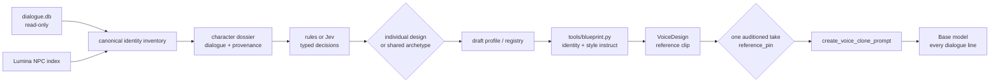
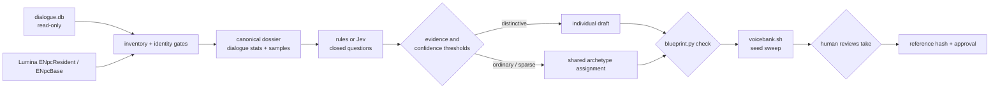

# Voice blueprints

A blueprint is one character's synthetic voice, written as a closed-vocabulary
selection rather than free prose. The pipeline is VoiceDesign → reference clip →
ICL prompt → dialogue lines; the blueprint describes the first step and keeps
every later step reproducible.



Nothing here generates audio into a pack. `./scripts/voicebank.sh` renders a
reference plus three sample lines per blueprint, so a voice can be auditioned
before it costs 2,000 lines. The instruct is the identity sentence plus the
profile's speech-style clause when it has one; there is no mood layer.

## Status

Phase 1 remains the existing in-game voice cloning path and is not changed by
the synthetic pipeline. Phase 2 now builds a conservative candidate inventory,
dialogue dossiers, offline rules and optional Jev classification, reusable archetype assignments, draft profiles, review reports,
and human audition/approval records. The pipeline stops before runtime pack
generation; approval remains a human action.

| Link | State |
|---|---|
| blueprint → reference clip | **solved.** `tools/blueprint.py` renders and validates the instruct; VoiceDesign turns it into a clip. |
| reference clip → dialogue lines | **solved and deterministic.** Every line is cloned from one frozen clip; same seed reproduces byte-identical audio, five draws verified. |
| game/dialogue → synthetic blueprint draft | **implemented.** `tools/blueprint_pipeline/cli.py` creates dossiers, classifies with local rules or opt-in Jev, and routes to a draft profile or shared archetype. |
| draft → approved reference | **human-gated.** Review commands record edits, audition WAV hashes, and approval; no classifier can approve a voice. |

`blueprints/characters/` contains only intentional reviewed profiles. The four
hand-written examples (gerolt, godbert, momodi, nashu_mhakaracca) remain in the
gitignored `blueprints/archive/` as renderer fixtures. Six initial shared
archetypes live in `archetypes/`; all are drafts until a human auditions and
approves a pinned reference.

### The intended pipeline



The pipeline is now game-data and dialogue only; the MediaWiki enrichment source
was removed on 2026-11-03. Identity metadata comes from the game's own NPC index,
and every acoustic field is either a casting rule applied to those facts or an
explicit creative selection.

The initial policy uses a small shared archetype catalog for ordinary or sparse
identities and reserves an individual draft for high distinctiveness scores
with adequate evidence. Archetype choice is deterministic and filters on the
game's own sex field so a masculine assignment never lands on a feminine bank.
Individual drafts no longer inherit acoustics from a bank: their acoustic fields
come from `tools/blueprint_pipeline/casting.py`, which applies readable rules to
game facts (race, clan, sex, body type) plus a stable per-NPC choice. See
`docs/blueprint-decisions.md` for the full decision table.

## Files

| Path | Role |
|---|---|
| `vocabulary.json` | Every allowed value, its render phrase, its acoustic family, the selection rules, the style render template, and the shared reference script. |
| `schema.json` | Structural JSON Schema. Enum membership and the rules live in the vocabulary. |
| `characters/<id>.json` | Intentional character profiles; generated drafts remain under gitignored `data/blueprints/profiles/`. |
| `archetypes/*.json` | Six shared synthetic profiles, all initially marked draft. |
| `archive/characters/*.json` | Gitignored hand-written examples that proved the pipeline out. |
| `tools/blueprint.py` | Validates a profile and renders the VoiceDesign instruct. |
| `tools/blueprint_pipeline/` | Read-only inventory, dossiers, Jev, rules, archetypes, generation, review, and reporting components. |
| `tools/voicebank/run.py` | Container-side renderer: reference, N sample lines, report, audition page. |
| `scripts/voicebank.sh` | Host wrapper that runs it inside the `tts-qwen` image. |

## What the instruct contains

1. **Identity** — who the voice is. Constant for the character and identical
   across every line. These are the acoustic fields the blueprint selects.
2. **Speech style** — a closed description of how the dialogue is phrased. When
   a profile carries style labels, their rendered clause is appended to the
   identity sentence by default (see [Speech style](#speech-style)).
3. **Reference recording** — one standard script, spoken by the designed voice,
   reused for every character.

## Selection rules

`select` in the vocabulary is authoritative; the validator enforces it.

| Field | Count | Notes |
|---|---|---|
| `presentation` | exactly 1 | Vocal presentation, not gender identity. |
| `perceived_age` | 0–1 | Perceived vocal age. Lore years are mapped, never copied blindly. |
| `pitch` | exactly 1 | Register only; expression belongs to intonation and the style clause. |
| `pitch_range` | 0–1 | Omit when unsure. |
| `timbre_primary` | exactly 1 | The main source of character differentiation. |
| `timbre_secondary` | 0–1 | Must be from a different acoustic family; two roughness words is one instruction, not two. |
| `resonance` | 0–1 | Most profiles omit this. |
| `articulation` | exactly 1 | |
| `speaking_pace` | exactly 1 | A voice property, not an emotion. |
| `intonation` | exactly 1 | `natural` unless the source says otherwise. |
| `accent` | 0–1 pair | Profile and strength together or neither. |
| `distinctive_traits` | 0–2 | Embellishments; must not repeat an existing family. |

Extremes are gated: `very_low`, `very_high`, `very_slow`, `very_fast`,
`dramatic`, `melodic`, `monotone`, `slurred`, `drawling`, `staccato`, `sharp`,
`nonhuman`, and `synthetic` require `explicit` or `supported_inference`
evidence. Taste alone cannot produce them.

## Evidence

Every non-null field carries an evidence record:

| Level | Meaning | Needs source + quote |
|---|---|---|
| `explicit` | The source states it | yes |
| `supported_inference` | Several source statements agree | yes |
| `creative_selection` | A design choice inside the vocabulary | no |
| `default` | Project fallback (accent, natural intonation) | no |
| `unknown` | No reliable information; field is null | no |

The point is auditability: after 9,000 profiles, "why does this character sound
like this" must have an answer that is not "the model felt like it".

## Phase 2 operations

The inventory and dossier commands open SQLite read-only. `dialog_speakers`
associations collapse aliases under one `npc_id`; identities with a voiced
alias, ambiguous links, or a normalized-name collision are review-blocked.
Unresolved labels remain review records and never become fabricated NPCs.
Only `dialogue` and `narration` rows enter the dossier. Statistics are
deterministic, and sample selection is stable across runs.

```bash
# Optional localized Lumina metadata. The command prints JSON and does not
# modify the dialogue DB; store the export outside the repository/data tree.
dotnet run --project tools/xivdata -- npc-index --lang en > /tmp/game-npc-index.json

python3 tools/blueprint_pipeline/cli.py inventory --game-index /tmp/game-npc-index.json
python3 tools/blueprint_pipeline/cli.py dossiers --game-index /tmp/game-npc-index.json --limit 25
python3 tools/blueprint_pipeline/cli.py classify --provider rules --limit 25

# Jev defaults to a loopback endpoint. Remote endpoints require --allow-remote.
python3 tools/blueprint_pipeline/cli.py classify --provider jev --limit 25

python3 tools/blueprint_pipeline/cli.py inspect npc_1003075 --review-report
python3 tools/blueprint_pipeline/cli.py validate
python3 tools/blueprint_pipeline/cli.py report
```

Loopback Jev endpoints need no network opt-in; non-loopback endpoints are
rejected unless `--allow-remote` is passed explicitly. Jev defaults to at most
25 records per invocation. Larger batches require `--allow-bulk`, and the CLI
prints request count, approximate input tokens, and a rough cost estimate
before sending. `--resume` reuses matching dossier/config/model results;
`--force` reruns classification and explicitly permits a generated result to
replace a manually reviewed profile. API credentials are read from the named
environment variable and never saved in a profile or cache.

Jev uses TypeSafe System One with `jev-latest` by default. Its `choice`,
`score`, and `noul` answers are retained with probability distributions,
confidence where provided, model version, token usage, and input/config hashes.
Noul is a yes-probability and has no separate confidence field. Thresholds are
initial project settings, not accuracy guarantees; low-confidence decisions
route to review or an archetype. Jev reads text/JSON only: it cannot hear
audition clips or supply citations.

Game race, clan, and sex are identity metadata, never acoustic evidence.
Rules-only presentation defaults to neutral. Every non-null acoustic field is
marked `explicit`, `supported_inference`, `creative_selection`, or `default`;
synthetic choices do not claim what a nonexistent original actor sounded like.
Speech-style measurements and classifications are stored separately from the
identity fields; the rendered style clause is appended to the instruct. The neutral reference script remains
unchanged.

Use the review command to preserve a human audit trail:

```bash
python3 tools/blueprint_pipeline/cli.py review edit npc_123456 --by reviewer \
  --changes /tmp/voice-edits.json
python3 tools/blueprint_pipeline/cli.py review audition archetype_neutral_clear_mid \
  --by reviewer --reference /path/to/audition.wav --seed 20261101
python3 tools/blueprint_pipeline/cli.py review approve archetype_neutral_clear_mid \
  --by reviewer
```

An identity edit retires old pins into the history and returns the profile to
`ready_for_audition`. Only human review can set `approved`; generation lookup
reports a profile as usable only after that approval. Draft profiles and
assignment registries are immutable snapshots under gitignored `data/`.

## Speech style

The five taxonomy-v3 style fields (`register`, `lexical_complexity`,
`sentence_complexity`, `colloquialism`, `discourse_style`) are classified from
dialogue and stored in the profile with their evidence and method. `render_instruct`
appends every supported field after the identity sentence, omitting missing
fields; the identity text itself never changes. All five fields remain
experimental and unvalidated until the v3 pilot, human gold, JEV stability, and
VoiceDesign A/B gates clear; `discourse_style` is the least established because
its taxonomy is new.

Listening on 2026-11-03 preferred styled takes over identity-only takes for
every sampled voice, so the clause is part of the default render rather than an
optional flag. That is a listening preference, not a benchmark result. The
earlier mood layer was removed on the same date: it was a second reference per
state, and its interaction with the style clause made delivery changes hard to
attribute.

Style is still not a per-line control. The Base model speaks the text it is
given, and the text already carries its own wording; the clause describes the
voice's baseline performance, chosen once with the reference.

## Reference script

One text for everyone, 32 words, from `vocabulary.json`:

> Good evening. The road ahead is quiet tonight, although the weather may
> change before morning. Keep to the marked path, and listen for the bells.
> Have you brought everything you need?

It has statements, a clause, and a question, so the clip carries declarative and
interrogative prosody without acting. Target 10–15 s; anything outside 8–18 s is
rejected rather than trimmed. The exact transcript is stored with the clip
because ICL needs `ref_text` to match the audio word for word.

Check the first two seconds of a new clone: there is a known upstream report of
the reference tail leaking into the start of ICL output.

## CLI

```bash
python3 tools/blueprint.py check                       # all profiles
python3 tools/blueprint.py check blueprints/characters/gerolt.json
python3 tools/blueprint.py render gerolt               # identity + style instruct
python3 tools/blueprint.py plan gerolt --out /tmp/plans
./scripts/voicebank.sh                                  # every blueprint, 3 samples each
./scripts/voicebank.sh gerolt godbert                   # two blueprints
./scripts/voicebank.sh --samples 5 nashu_mhakaracca
./scripts/voicebank.sh --seeds 5 --samples 2 godbert     # same instruct, five takes
```

`check` also warns when two profiles select an identical identity tuple: with
hundreds of NPCs, accidental clones are the failure mode nobody notices.

## Reconciliation of the two research drafts

`research/grok.md` and `research/chatgpt.md` agree on the shape: select acoustic
dimensions from a controlled list, render a short natural-language instruct,
use one standard reference script. They differ in detail,
and the tighter rule won each time:

| Question | Grok | ChatGPT | Adopted |
|---|---|---|---|
| Gender field | male / female / neutral | 12 values incl. modifiers | 6 presentations, `presentation` not gender |
| Timbre count | 1–3 | 1 + optional 1 | 1 + optional 1, with family conflicts rejected |
| Reference script | four suggestions | one canonical script | one canonical script |
| Emotion in identity | a "baseline emotion" field | forbidden | forbidden, and the validator bans emotion words |
| Prompt length | 15–40 words | 25–45 words | 25–48 words |
| Evidence levels | none | five levels | adopted |

The one thing kept from Grok that ChatGPT omitted: selection counts are part of
the spec, not a style note. "Use one value" and "use up to two" are validated,
not advised.

## Measured on the first bank

Four profiles, run 2026-11-01 (`./scripts/voicebank.sh`); the mood rows from that
run were removed with the mood layer:

| Voice | Reference | Clone medians (3 lines) |
|---|---:|---:|
| gerolt | 10.9 s, 93 Hz | 87, 92, 89 |
| godbert | 10.5 s, 92 Hz | 104, 87, 83 |
| momodi | 10.2 s, 205 Hz | 210, 205, 183 |
| nashu_mhakaracca | 10.6 s, 233 Hz | 261, 220, 286 |

Every reference landed inside the 10–15 s target on the first try, and
presentation separates cleanly: masculine references sit at 78–103 Hz,
feminine at 205–264 Hz.

Two findings for the pipeline:

- **Line pitch scatters by up to ~65 Hz** around the reference median within one
  voice. A blueprint fixes the design, not every frame: budget 2–3 clone lines
  per voice in acceptance, and never judge a profile from one clip.
Listening verdict 2026-11-01: the reference voices sound excellent on their
own. Listening on 2026-11-03 preferred the styled renders over identity-only
renders for every sampled voice.

`report.json` records `ref_seconds`, `ref_f0`, `line_seconds`, and `line_f0`
per take, so a rerun can be compared without re-listening to everything.

## Seed sweeps

`--seeds N` rebuilds the reference N times from the same instruct, offsetting the
plan seed by `--seed-step` (1000 by default). The identity is identical; only
the sampling draw changes. Use it to choose between candidate voices for one
blueprint, not to average them: a character gets one take, and that take becomes
its pinned reference.

Godbert, five takes, two sample lines each (2026-11-01):

| Take | Seed | Ref | Ref F0 | Line F0 |
|---:|---:|---:|---:|---|
| 0 | 20652794 | 10.48 s | 92.0 Hz | 92.3, 87.6 |
| 1 | 20653794 | 10.64 s | 103.4 Hz | 97.6, 108.1 |
| 2 | 20654794 | 10.88 s | 94.5 Hz | 87.3, 92.7 |
| 3 | 20655794 | 10.08 s | 100.4 Hz | 96.2, 94.1 |
| 4 | 20656794 | 10.16 s | 98.4 Hz | 93.8, 94.9 |

Reference pitch spans 92.0–103.4 Hz (11.4 Hz) for one unchanged instruct, and
every take stayed inside the duration target. Seed changes the realized voice,
not the design: it is a casting knob, so a blueprint is only finished once one
take is chosen.

### What pinning actually pins

The **reference clip**, not a line seed. Every dialogue line is generated from
`create_voice_clone_prompt(ref_audio=<frozen wav>)`, so once the reference is
chosen and stored, all ~2,000 lines of that character share one identity — with
no per-line seed at all.

Measured on the Godbert takes above (ECAPA speaker-embedding cosine, 1.0 = same):

| Comparison | Cosine |
|---|---|
| two lines from the *same* take, different line seeds | 0.991–0.994 |
| two lines from *different* takes | 0.984–0.994 |

Six unseeded lines per take, emulating a pack run: take 0 mean 93.9 Hz (sd 5.2),
take 1 mean 96.6 Hz (sd 5.3), gap between takes 2.7 Hz. Per-line scatter within
one take is larger than the mean gap between takes — so a line seed buys nothing
for identity, while the reference clip buys all of it.

A design seed alone is not a durable pin either: dtype, attention backend, torch
build, or a reference-script edit will change the clip under the same seed. Pin
the clip and its hash, and record the seed only for reproducibility:

```json
"reference_pin": {
  "design_seed": 20652794,
  "reference_sha256": "<sha256 of refs/take.0.wav>",
  "ref_seconds": 10.48,
  "pinned_on": "2026-11-01"
}
```

A hash mismatch on rebuild means the voice changed and must be re-approved,
rather than silently re-casting the character. When available, the pin also
records the exact combined `instruct`, the Style taxonomy/classifier/prompt/
sampler versions, the corpus hash, and the sample-manifest hash, so the WAV can
be traced to the evidence that produced it.

## Known limits

- Accent clauses are unverified: Qwen3-TTS has no accent mode, so treat them as
  hints until a listening test proves otherwise.
- `nonhuman` and `synthetic` presentations are experimental; the model is a
  speech generator and may render them as odd human voices.
- English only for now. The vocabulary and script are language-agnostic, but no
  other language has been auditioned.
